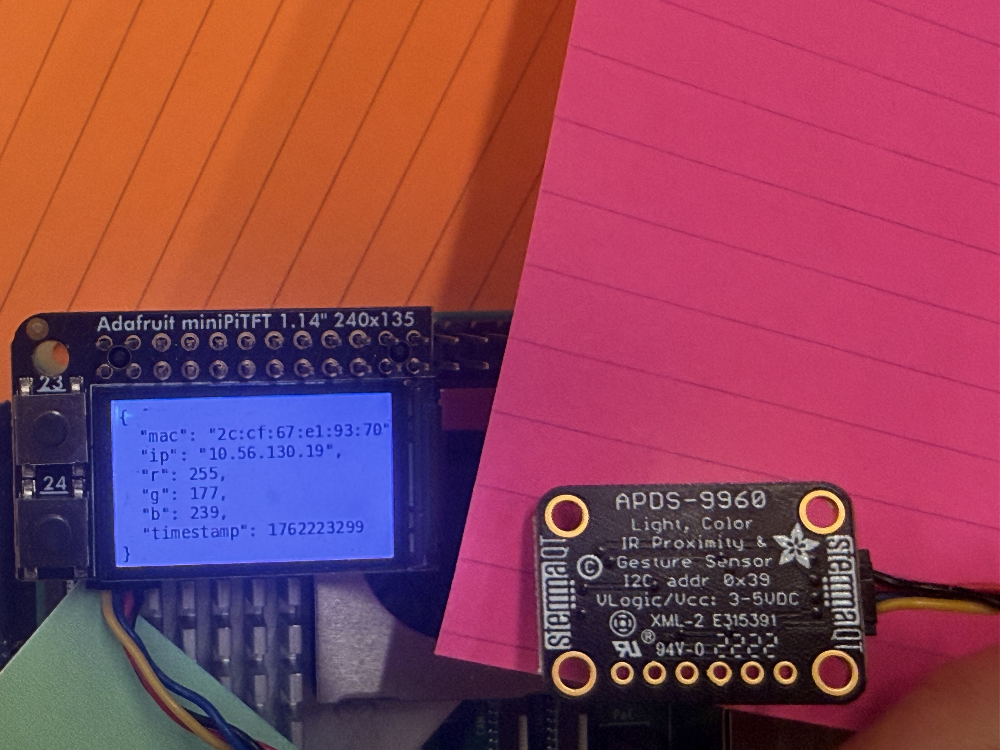

# Distributed Interaction

**Stephen Monahan (sm3257)
  Jonathan Sharpy (jjs564)
  Gal Alon (ga386)**

For submission, replace this section with your documentation!

---

## Prep

1. Pull the new changes
2. Read: [The Presence Table](https://dl.acm.org/doi/10.1145/1935701.1935800) ([video](https://vimeo.com/15932020))

## Overview

Build interactive systems where **multiple devices communicate over a network** using MQTT messaging. Work in teams of 3+ with Raspberry Pis.

**Parts:**
- A: Learn MQTT messaging
- B: Try collaborative pixel grid demo  
- C: Build your own distributed system

---

## Part A: MQTT Messaging

MQTT = lightweight messaging for IoT. Publish/subscribe model with central broker.

**Concepts:**
- **Broker**: `farlab.infosci.cornell.edu:1883`
- **Topic**: Like `IDD/bedroom/temperature` (use `#` wildcard)
- **Publish/Subscribe**: Send and receive messages

**Install MQTT tools on your Pi:**
```bash
sudo apt-get update
sudo apt-get install -y mosquitto-clients
```

**Test it:**

**Subscribe to messages (listener):**
```bash
mosquitto_sub -h farlab.infosci.cornell.edu -p 1883 -t 'IDD/#' -u idd -P 'device@theFarm'
```

**Publish a message (sender):**
```bash
mosquitto_pub -h farlab.infosci.cornell.edu -p 1883 -t 'IDD/test/yourname' -m 'Hello!' -u idd -P 'device@theFarm'
```

> **💡 Tips:**
> - Replace `yourname` with your actual name in the topic
> - Use single quotes around the password: `'device@theFarm'`
> - For your own projects, publish under your team's topic space: `IDD/<yourteam>/...` (for example `IDD/team3/bedroom/light`). Everyone shares one broker login, so anything you publish can reach everyone's projects.

**🔧 Debug Tool:** View all MQTT messages in real-time at `http://farlab.infosci.cornell.edu:5001`


**💡 Brainstorm 5 ideas for messaging between devices**

MQTT agrees on almost nothing in advance: you invent the topics and what the messages mean. Smart-home standards like Matter fix the vocabulary instead (every "light" behaves the same). Keep this trade-off in mind when you design your topics in Part C.

---

## Part B: Collaborative Pixel Grid

Each Pi = one pixel, controlled by RGB sensor, displayed in real-time grid.

**Architecture:** `Pi (sensor) → MQTT → Server → Web Browser`

**Setup:**

1. **Sensor**

#### Light/Proximity/Gesture sensor (APDS-9960)
We use this sensor [Adafruit APDS-9960](https://www.adafruit.com/product/3595) for this exmaple to detect light (also RGB)
 


Connect it to your pi with Qwiic connector



We need to use the screen to display the color detection, so we need to stop the running piscreen.service to make your screen available again

```bash
# stop the screen service
sudo systemctl stop piscreen.service
```

if you want to restart the screen service
```bash
# start the screen service
sudo systemctl start piscreen.service
```
 
2. **Server** (one person on laptop):
```bash
cd "Lab 6"
python -m venv .venv
source .venv/bin/activate
pip install -r requirements-server.txt
python app.py
```

2. **View in browser:**
   - Grid: `http://farlab.infosci.cornell.edu:5000`
   - Controller: `http://farlab.infosci.cornell.edu:5000/controller`

3. **Pi publisher** (everyone on their Pi):
```bash
# First time setup - create virtual environment
cd "Lab 6"
python -m venv .venv
source .venv/bin/activate
pip install -r requirements-pi.txt

# Run the publisher
python pixel_grid_publisher.py
```

Hold colored objects near sensor to change your pixel!


**📸 Include: Screenshot of grid + photo of your Pi setup**


---

# Part C: NEON RACE | Distributed Multiplayer Reaction Game

## C.1 Project Overview

For Part C, our team developed **NEON RACE**, a multiplayer physical reaction game built around Raspberry Pis, sensor inputs, MQTT messaging, and small interactive displays.

The concept combines a traditional reaction-time competition with physical sensing.

Rather than simply pressing a button, players respond to challenges by presenting colored objects or performing recognized physical actions.

Each Raspberry Pi operates as an independent sensing device while participating in a shared multiplayer session.

The goal is to respond accurately and quickly enough to win rounds and accumulate the highest score.

## C.2 User Experience

The intended interaction proceeds through several stages:

**1. Lobby**

Each Raspberry Pi launches NEON RACE and connects to the shared MQTT session. Players wait for the host to begin the match.

**2. Challenge**

The host coordinates a challenge, such as showing a particular color or performing a supported physical gesture.

**3. Physical Response**

Players respond using their own connected sensors.

**4. Detection**

Each Raspberry Pi processes its sensor input locally and determines whether the requested action has been completed.

**5. Multiplayer Result**

The game communicates completion information through MQTT, determines the round outcome, and updates the shared match state.

**6. Final Result**

After the configured rounds, the game displays the match results.

This interaction makes network communication visible through physical actions and synchronized feedback.

## C.3 Hardware and Software

The project was developed for a three-person team using Raspberry Pis.

Our working prototype incorporated the following components:

| Component | Function |
|---|---|
| Raspberry Pi | Runs the game application and handles networking |
| miniPiTFT display | Displays game states, instructions, and feedback |
| APDS-9960 sensor | Detects colors and proximity-based inputs |
| USB webcam | Supports camera-based gesture recognition when available |
| MQTT broker | Distributes multiplayer messages |
| Python | Implements sensing, interaction logic, and game behavior |
| MediaPipe | Supports hand-gesture processing |
| OpenCV | Provides camera access and image processing |

The APDS-9960 enabled sensor-based interaction without requiring a camera for every challenge.

Camera-based gesture recognition provided an additional interaction method where a working webcam was available.

## C.4 Distributed System Architecture

```text
                 GAME HOST
             Raspberry Pi / PiTFT
                       |
               Game Coordination
                       |
                       v
                 MQTT Broker
                       |
          +------------+------------+
          |            |            |
          v            v            v
       Player 1     Player 2     Player 3
          |            |            |
       Sensors      Sensors      Sensors
          |            |            |
          v            v            v
     Local Input   Local Input   Local Input
      Detection     Detection     Detection
          |            |            |
          +------------+------------+
                       |
                       v
                MQTT Messages
                       |
                       v
              Shared Game State
                       |
                       v
               Round Results
```

The system separates two responsibilities:

**Local computation:** Each Raspberry Pi acquires sensor readings and interprets physical input.

**Distributed coordination:** MQTT allows the devices to exchange game events and maintain a shared multiplayer interaction.

This separation is important because processing raw sensor data centrally would introduce unnecessary network traffic and increase dependence on network performance.

Instead, each device can perform local sensing and transmit the resulting game information.

## C.5 MQTT Communication

NEON RACE used a shared team namespace to coordinate its multiplayer session.

Our player configuration used:

```text
IDD/ct-neon/race
```

The team identifier ensured that participating devices joined the same game rather than an unrelated MQTT session.

The implementation used MQTT to communicate game-related information between the participating Raspberry Pis.

The main categories of information included:

- Player presence and session coordination
- Game challenges and state changes
- Sensor-based completion events
- Round outcomes and scores

The exact message handling and topic structure are implemented in the source code linked below.

## C.6 Software Implementation

The team used a Python implementation integrating physical sensing, graphical output, and multiplayer communication.

### Source Files

**[View NEON RACE Python implementation](https://github.com/jjs564-gif/Interactive-Lab-Hub/blob/Fall2026/Lab%206/media/neon_race/code/neon_race.py)**

**[View NEON RACE dependencies](https://github.com/jjs564-gif/Interactive-Lab-Hub/blob/Fall2026/Lab%206/media/neon_race/code/requirements-neon.txt)**

The application includes several important responsibilities.

**Sensor initialization:** Establishes connections to supported hardware and determines available input capabilities.

**Local interpretation:** Converts camera and sensor measurements into recognized interaction events.

**MQTT communication:** Connects the player to the shared broker and exchanges multiplayer messages.

**Game state management:** Coordinates the lobby, challenge sequence, results, and scoreboard.

**Display feedback:** Presents game information on the Raspberry Pi's miniPiTFT screen.

### Running the Game

After installing the dependencies in a Python virtual environment, a participating Raspberry Pi can launch the application with a player name and shared team identifier.

Example player command:

```bash
python neon_race.py --name pi2 --team ct-neon
```

Example host command:

```bash
python neon_race.py --host --name pi1 --team ct-neon
```

The host and players must use the same team identifier.

The application also supports configurations that exclude camera input when the webcam is unavailable.

## C.7 Development and Integration Process

Our implementation involved several stages of testing and troubleshooting.

### Stage 1: Establishing Network Communication

We first verified MQTT functionality during Part A.

This provided confidence that the Raspberry Pi could communicate through the course broker before introducing the additional complexity of multiplayer gameplay.

### Stage 2: Validating Physical Sensor Input

During Part B, we successfully demonstrated RGB sensing through the APDS-9960 and the shared pixel grid.

This established that physical color measurements could be translated into networked interactions.

### Stage 3: Integrating NEON RACE

For Part C, our team adopted the NEON RACE implementation and configured the participating Raspberry Pis with matching MQTT team identifiers.

We installed the required Python dependencies in isolated virtual environments to avoid interfering with the Raspberry Pi's system Python installation.

We also tested camera initialization and investigated compatibility issues with USB webcams and gesture-recognition dependencies.

### Stage 4: Camera Troubleshooting

During initial testing, one Raspberry Pi reported that its USB webcam could not be opened.

After reconnecting the camera and restarting the application, MediaPipe initialization progressed further.

This highlighted the importance of verifying hardware availability before launching a multiplayer session.

The system's ability to use color and proximity inputs provided a useful alternative when camera-based interaction was unavailable.

### Stage 5: Multiplayer Demonstration

The original design targeted three active Raspberry Pis.

However, one teammate experienced a PiTFT display malfunction during integration, preventing that device from participating fully.

After consulting DTA Albert, we proceeded with an approved two-player demonstration.

This allowed us to validate a working multiplayer interaction while documenting the hardware limitation that prevented the intended three-player demonstration.

## C.8 Final Demonstration

**[Watch NEON RACE Multiplayer Demonstration](https://drive.google.com/file/d/11VT5Zs120NAuV9nys2I1SqoBgyaAqhUp/view?usp=sharing)**

The recording documents the functional two-player version of NEON RACE.

It demonstrates the physical Raspberry Pi interface and the coordinated multiplayer interaction.

Although the original concept was designed for three players, the final working demonstration involved two active devices because of the third device's display malfunction.

The video provides evidence of the functional prototype and the interaction achieved during testing.

## C.9 User Testing

The assignment requested testing with at least two participants who were not members of the development team.

Our intended external testing was constrained by the limited number of students remaining in the classroom when the prototype became operational.

During the available class time, we prioritized troubleshooting the hardware, establishing reliable multiplayer communication, and capturing a functional demonstration.

As a result, we did not complete two independent non-team user-testing sessions.

This is a limitation of our evaluation rather than evidence that the system has been validated with unfamiliar users.

### Future User-Testing Plan

A subsequent evaluation would involve two or more participants unfamiliar with NEON RACE.

We would investigate:

- **Expectations:** What do participants believe the game will require before receiving instructions?
- **Challenge clarity:** Can participants understand the requested actions immediately?
- **Sensor reliability:** Do the sensors recognize the intended actions consistently?
- **Feedback:** Can players identify when they have completed a challenge and who won?
- **Improvements:** What would participants change about the controls, timing, or game presentation?

These observations would help distinguish implementation reliability from actual usability.

## C.10 Reflection

### What Worked Well?

The most successful aspect of NEON RACE was turning independent Raspberry Pis into a shared multiplayer experience.

The combination of physical sensor input, local computation, MQTT communication, and visual feedback created a more interactive demonstration than a conventional messaging test.

The APDS-9960 also proved useful across multiple parts of the assignment, first contributing RGB measurements to the collaborative grid and then supporting physical game interactions.

### What Were the Main Challenges?

The largest challenge was coordinating several hardware and software components simultaneously.

A device could successfully connect to MQTT while still encountering a problem with its camera, display, or sensor initialization.

We encountered webcam initialization issues and a PiTFT malfunction that reduced the final demonstration from three participating Pis to two.

These challenges reinforced the importance of testing individual subsystems before attempting full integration.

### How Did Sensor Events Work?

The Raspberry Pi collected physical input through its available sensors.

The application interpreted these measurements locally to determine whether an interaction matched a game challenge.

Relevant game events were then communicated through MQTT, allowing other devices to respond to the shared game state.

This approach reduced the need to transmit raw camera imagery between devices.

### Where Did Computation Happen, and Why?

Sensor acquisition and interpretation occurred locally on the Raspberry Pis.

Multiplayer coordination used MQTT messaging, allowing the devices to communicate without directly sharing raw sensor streams.

This division supported a more modular architecture, where each Raspberry Pi was responsible for interpreting its own physical environment.

The design also supported privacy by keeping camera frames on the local device rather than transmitting them through MQTT.

### What Would We Improve?

Our first priority would be restoring reliable three-device participation and testing the complete intended configuration.

Additional improvements would include more robust camera detection, better sensor calibration across different lighting conditions, clearer connection-status feedback, and improved recovery when a device disconnects.

We would also conduct structured external user testing to determine whether the game is intuitive for people unfamiliar with its implementation.

For a competitive reaction game, it would be valuable to investigate the effects of MQTT latency and differences in sensor processing time on round outcomes.

## C.11 Team Collaboration and AI Assistance

Our team consisted of **Jonathan Sharpy, Gal Alon, and Stephen Monahan**. We developed NEON RACE through several iterations, beginning with the initial concept and progressing toward a fully integrated multiplayer reaction game.

**Jonathan Sharpy | Initial Implementation and Hardware Integration**

- Jonathan completed the MQTT publish/subscribe testing and verified successful communication through the Cornell course broker.
- He configured and tested his Raspberry Pi and APDS-9960 RGB sensor for the collaborative pixel grid.
- He developed our first working iteration of the multiplayer reaction game, exploring shared challenges, physical sensor responses, and MQTT communication.
- He configured his Python environment, connected the camera and sensor, and helped integrate the final NEON RACE implementation.
- He organized the supporting screenshots, source files, demonstration video, and final README documentation.

**Gal Alon | Concept Development and Interaction Design**

- Gal proposed our original multiplayer reaction game concept, where multiple Raspberry Pis compete to complete the same sensor-based challenge.
- His concept established the core gameplay structure, including synchronized tasks, physical responses, round winners, and scoring.
- He contributed to our discussions about MQTT communication, system architecture, and gameplay improvements.
- He participated in our integration and troubleshooting process.

**Stephen Monahan | Final Implementation and Software Development**

- I developed the final NEON RACE implementation that our team ultimately used.
- My version expanded our initial prototype into a more advanced game, incorporating graphical PiTFT feedback, sensor-based challenges, MQTT coordination, and multiplayer scoring.
- I helped configure and integrate the software across our Raspberry Pis.
- I participated in debugging and testing the final multiplayer interaction.

### Collaborative Integration and Troubleshooting

While each of us led different parts of the project, we worked together throughout the integration process.

We verified that our Raspberry Pis had the correct Python environments, dependencies, and source files. To streamline setup, we shared a document containing the required files and terminal commands in the correct execution order.

We also worked together to troubleshoot camera initialization, sensor availability, MQTT communication, and hardware compatibility. One of our largest challenges was Gal's PiTFT display, which we all attempted to troubleshoot but were ultimately unable to restore during the available class time.

After consulting DTA Albert, we proceeded with a two-device multiplayer demonstration. Our final test successfully demonstrated physical sensor interactions, MQTT communication, and coordinated game feedback, which we documented in our video.

### AI Assistance

Throughout the project, we used AI tools, including **ChatGPT and Claude**, to assist with brainstorming, understanding MQTT communication, developing the initial game implementation, refining our interaction concept, troubleshooting software dependencies, and organizing our documentation.

We reviewed and tested the AI-assisted suggestions through actual implementation on our Raspberry Pis. I developed the final NEON RACE application, building on Gal's original concept and our earlier prototype.

All hardware integration, physical testing, debugging, and the final multiplayer demonstration were carried out by our team.

### Final Reflection on Collaboration

This lab highlighted how iterative development and collaboration can improve an engineering project. Gal's initial concept provided the foundation for the game, Jonathan's first implementation helped us explore the technical approach, and my final version brought everything together into a more polished and interactive experience.

One of our biggest takeaways was that a distributed system depends on more than functional code. Every participating device needs compatible software, reliable sensors, working hardware, and consistent network communication.

Although we encountered hardware limitations that prevented our original three-player demonstration, we worked together to adapt the system and successfully demonstrate the multiplayer interaction using two Raspberry Pis.

---

# Final Deliverables

| Deliverable | Documentation |
|---|---|
| Part A: MQTT publisher and subscriber | [MQTT test screenshots](https://github.com/jjs564-gif/Interactive-Lab-Hub/tree/Fall2026/Lab%206/media/mqtt_tests/) |
| Part B: Collaborative pixel grid | [Sensor and grid images](https://github.com/jjs564-gif/Interactive-Lab-Hub/tree/Fall2026/Lab%206/media/part_b_images/) |
| Part C: NEON RACE source code | [Python implementation](https://github.com/jjs564-gif/Interactive-Lab-Hub/blob/Fall2026/Lab%206/media/neon_race/code/neon_race.py) |
| Part C: Python dependencies | [Requirements](https://github.com/jjs564-gif/Interactive-Lab-Hub/blob/Fall2026/Lab%206/media/neon_race/code/requirements-neon.txt) |
| Part C: Multiplayer video | [Video demonstration](https://drive.google.com/file/d/11VT5Zs120NAuV9nys2I1SqoBgyaAqhUp/view?usp=sharing) |

## Conclusion

Lab 6 demonstrated how multiple Raspberry Pis can communicate and coordinate physical interactions using MQTT.

We progressed from a simple publish/subscribe test to a collaborative color-sensing grid, and finally to NEON RACE, a multiplayer reaction game combining local sensing with distributed communication.

The final two-player demonstration showed the potential of the system while revealing practical challenges associated with coordinating multiple hardware devices.

The project strengthened our understanding of publish/subscribe communication, distributed computation, physical interaction design, and the importance of robust hardware integration.

